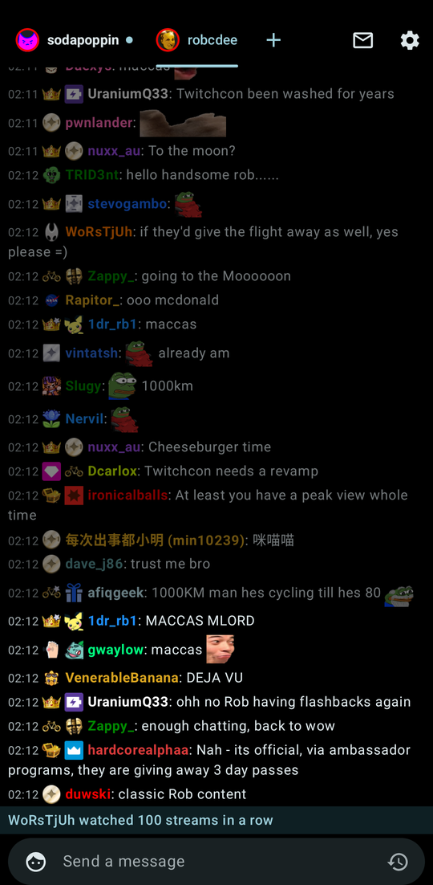
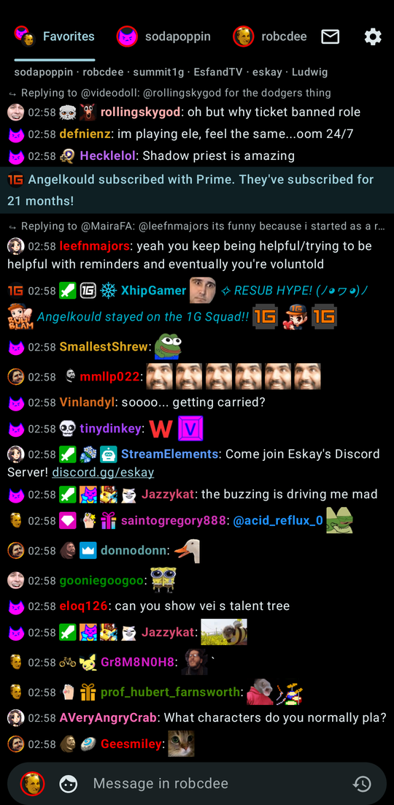
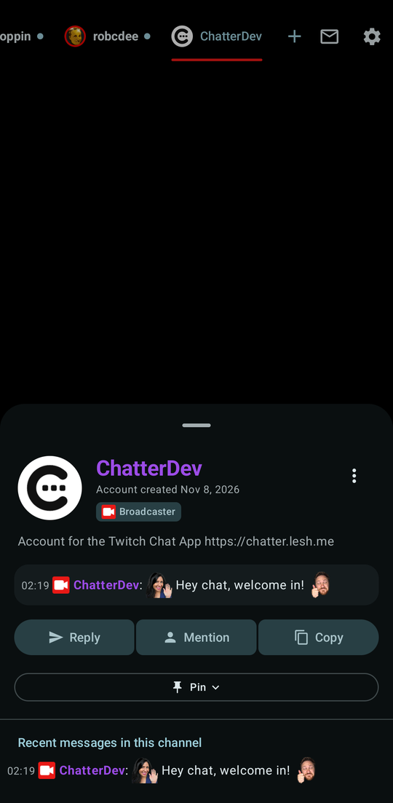
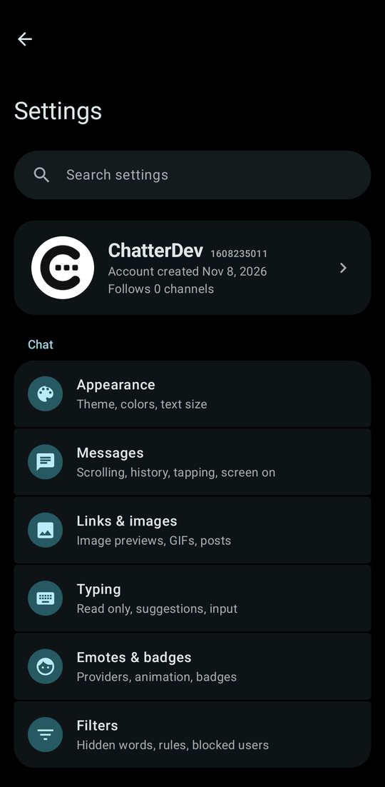

  <picture>
    <source media="(prefers-color-scheme: dark)" srcset="docs/brand/wordmark-dark.svg">
    
  </picture>

  A fast, native Twitch chat client for Android - based on Material 3, with full emote support for a rich chatting experience. 

  
  
  
  
  

  
  
  
  

> [!TIP]
> **Help bring Chatter to Google Play.** Chatter is in closed testing there. Before it can go
> public, Google requires at least 12 testers to stay in the test for 14 days in a row.
>
> 1. Join the [Chatter testers group](https://groups.google.com/g/chatter-dev-group/about). Google
>    Play lets only its members into the test.
> 2. Then [join the test on Google Play](https://play.google.com/apps/testing/me.lesh.chatter)
>    with the same Google account, and install Chatter from there.
> 3. Stay in the test for at least 14 days in a row.

## Install

**[Download the APK from the latest release](https://github.com/derLesh/Chatter/releases/latest)**
and open it on your phone. Android may ask you to let your browser install apps; that is normal
for an APK. Chatter needs Android 13 or newer. Reading works without an account;
writing needs a Twitch account.

**Google Play:** coming soon. Chatter is in closed testing there, and the box above says how to
join.

Want new features early? [Chatter Nightly](https://github.com/derLesh/Chatter/releases/tag/nightly)
is built every night. It may break, and it installs next to Chatter as an app of its own.

## What it does

**Read chat the way you like it**

- Open your channels as tabs and swipe between them
- Combine several channels into one chat, each message marked with its channel
- Twitch, 7TV, BetterTTV and FrankerFaceZ emotes, animated, with a picker sorted by channel and
  autocomplete
- Emoji in the picker too, or typed by shortcode: `:smi` offers 😄
- 7TV badges and paints on names, cheers as animated cheermotes, giant emotes and message effects
  like on Twitch
- Images, GIFs and posts from X and Bluesky shown right in the chat
- [Recent messages](https://recent-messages.robotty.de/) loaded as you join, so you most likely never see an empty chat
- A mark where you stopped reading, and replies you tap to read the whole conversation
- Read as a guest, and log in only when you want to write

**Make it look like yours**

- Text size, line spacing, timestamps and name colours under your control
- Pick which badges and special messages you see
- Light, dark or pure black, with Material You colours
- App icons in eight colours or Pride

**Never miss being mentioned**

- Mentions and whispers arrive as notifications the moment they are sent, and can be answered
  right there
- An inbox collecting everything addressed to you across all your channels
- Your own highlight words and rules for what deserves an alert, with a sound and vibration per
  channel
- Follow a conversation and get notified about new replies in it
- A notification when a channel goes live, with its title and category: your channels, and any
  followed channel you pick

**Stay in the conversation**

- Chat bubbles keep a channel floating over whatever else you are doing
- Schedule messages for a later time
- Quickly get your last three messages
- Whispers in a chat of their own, one conversation per person
- User cards with badges, recent messages and a private note
- Nicknames for chatters, mute filters, blocking and reporting
- Change chat modes and pin messages in channels you moderate
- Switch between several Twitch accounts

**Yours, and nobody else's**

- No account beyond your Twitch login
- No ads, and nothing about you is sent to us
  ([privacy policy](https://chatter.lesh.me/privacy))
- Save your settings, rules and channels to a file, or take them along to a new phone
- Saves data on mobile networks, while the chat keeps arriving

## Security

Found a way to get at somebody's Twitch login, or a hole in a release or a workflow? Please report
it privately, as the [security policy](SECURITY.md) describes, not in a public issue.

## License

The source code is public so you can read it, check what the app does and contribute, but Chatter
is not open source. You may build it for your own use; you may not publish it, or use its code in
an app of your own, without asking first. The [LICENSE](LICENSE) has the details.

---

Chatter is an independent app and is not affiliated with, endorsed by or sponsored by Twitch Interactive, Inc.
